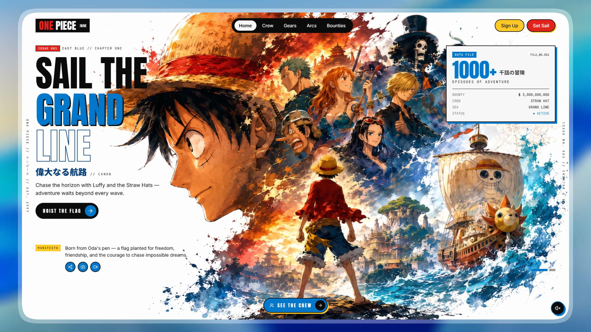

# 🏴‍☠️ New One-Piece-Page

### Set sail with the Straw Hat crew.

An immersive, cinematic One Piece fan experience for exploring the crew, their stories, and Luffy's transformations. Built with bold artwork, animated character showcases, bounty-inspired details, and a soundtrack you control.

<p align="center">
  <a href="https://new-one-piece-page.vercel.app">
    
  </a>
</p>

<p align="center">
  <a href="https://new-one-piece-page.vercel.app"><strong>⚡ Explore the live experience</strong></a>
  &nbsp; · &nbsp;
  <a href="https://www.linkedin.com/in/sayed-sadiq45/">LinkedIn</a>
  &nbsp; · &nbsp;
  <a href="https://github.com/SayedSadiq45">GitHub</a>
</p>

---

## ✨ The adventure

Move from the Grand Line to the New World, meet the Straw Hat Pirates, and explore Luffy's gears in a full-screen, image-led experience. Atmospheric motion and a soundtrack bring the voyage to life, while clear navigation and a persistent sound control keep the experience yours.

## 🧭 Explore

| Experience | What you'll find |
| --- | --- |
| **Grand Line** | A cinematic, animated home screen with rotating story highlights |
| **Straw Hat crew** | Character portraits, crew roles, bounty details, and individual profiles |
| **Luffy's gears** | A dedicated gallery of transformations and their signature artwork |
| **Soundtrack** | Persistent audio controls throughout the experience |

## 🎨 Made for the voyage

- **Artwork first:** Full-screen imagery and poster-inspired composition put the crew at the center.
- **Character-led color:** Each profile uses its own palette to give the roster a distinct feel.
- **Motion with purpose:** Animated slides and transitions add atmosphere while keeping every section easy to explore.
- **Responsive experience:** Adapted for desktop, tablet, and mobile screens.
- **Your choice of soundtrack:** Mute or enable audio at any time.

## 🛠️ Built with


- **React** and **TypeScript** for the interactive application
- **Vite** for local development and production builds
- **Tailwind CSS 4** for styling
- **Motion for React** for transitions and animation
- **Lucide React** for interface icons

## 🚀 Run it locally

You'll need [Node.js](https://nodejs.org/) and [pnpm](https://pnpm.io/).

```bash
git clone https://github.com/SayedSadiq45/New-One-Piece-Page.git
cd New-One-Piece-Page
pnpm install
pnpm dev
```

Open the local URL printed by Vite, usually [http://localhost:5173](http://localhost:5173).

Create and preview an optimized production build:

```bash
pnpm build
pnpm preview
```

## 👋 Connect with Sayed Sadiq

**Project creator and maintainer:** [Sayed Sadiq](https://github.com/SayedSadiq45)

- 💼 [Connect on LinkedIn](https://www.linkedin.com/in/sayed-sadiq45/)
- 💻 [Follow on GitHub](https://github.com/SayedSadiq45)
- 🌊 [Visit the live project](https://new-one-piece-page.vercel.app)

## 📜 Credits

This fan-made project is an independent, unofficial tribute to *One Piece*. *One Piece* and its characters belong to their respective rights holders; this project is not affiliated with or endorsed by them.

Third-party asset credits and license links are listed in [`ATTRIBUTIONS.md`](./ATTRIBUTIONS.md).

## 📄 License

The source code in this repository is available under the [MIT License](./LICENSE). Review [`ATTRIBUTIONS.md`](./ATTRIBUTIONS.md) for third-party components and assets, which retain their respective licenses.

---

<p align="center">
  <strong>Built with care by <a href="https://github.com/SayedSadiq45">Sayed Sadiq</a></strong><br>
  <a href="https://www.linkedin.com/in/sayed-sadiq45/">LinkedIn</a> ·
  <a href="https://github.com/SayedSadiq45">GitHub</a> ·
  <a href="https://new-one-piece-page.vercel.app">Live website</a>
</p>
